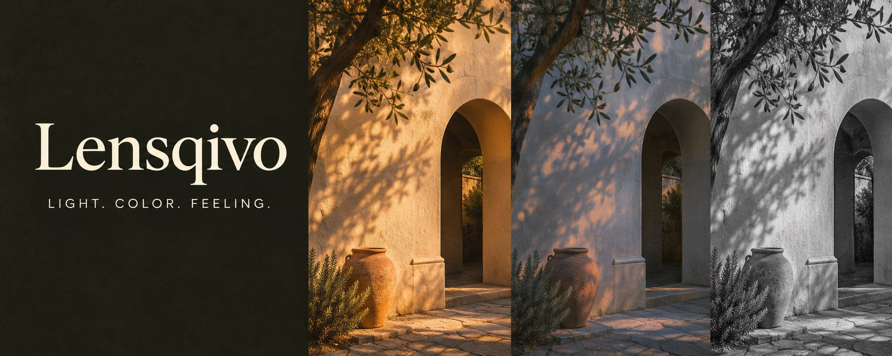
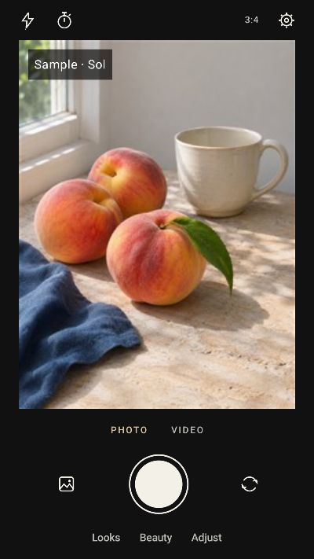
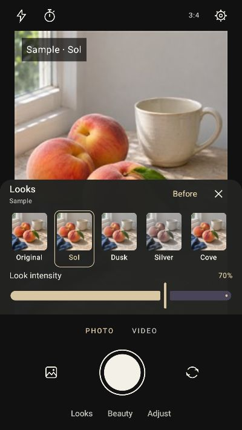
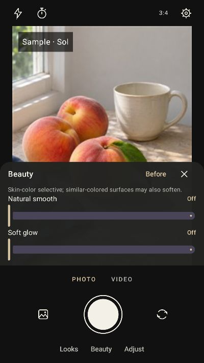

  

<h1 align="center">Lensqivo</h1>

  <strong>An everyday Android camera with a considered sense of color.</strong> 
  Native capture. Original live looks. A little more feeling in the frame.

  

  <a href="docs/EVALUATION.md">Evaluate Lensqivo</a> &nbsp;·&nbsp;
  <a href="#the-camera">The camera</a> &nbsp;·&nbsp;
  <a href="#build-it">Build it</a> &nbsp;·&nbsp;
  <a href="#under-the-viewfinder">Architecture</a> &nbsp;·&nbsp;
  <a href="#development-status">Development status</a>

> **Development build · v0.2.0**
>
> Native still capture, eight live looks and optional beauty controls on Android 10 or newer. See [Evaluation](docs/EVALUATION.md) for a screenshot walkthrough, development APK instructions and a local build path. Physical-device qualification is pending. The cover is original brand artwork.

## A name with a point of view

**Lensqivo** is pronounced **Lens-kee-vo**.

| Lens | Q | Vivo |
| :--- | :--- | :--- |
| Photography and camera optics | Quality | Vivid, lifelike imagery |

The idea is simple: a camera that puts the moment first, with a small collection of useful creative choices close at hand. Charcoal surfaces, warm paper tones and amber accents keep attention on the viewfinder.

## The camera

  
  
  

Native Compose UI rendered in an isolated emulator with a generated sample scene. The images illustrate the interface; physical-camera image quality requires separate validation. [Screenshot provenance](assets/README.md).

The following features are **implemented in source**. Device qualification is tracked separately in the [validation record](docs/validation.md).

| Capture | Color | Control |
| :--- | :--- | :--- |
| Native still JPEGs through CameraX | Eight original live looks | Tap-to-meter |
| MP4 video through CameraX Recorder | Adjustable look intensity | Capability-dependent zoom and exposure |
| Supported FHD → HD → SD selection | Original comparison with capture guard | Front / rear camera switching |
| Optional microphone audio | Skin-color-selective smoothness and soft glow | Composition grid, flash and 3/10-second timer |
| Private interrupted-photo recovery | Three reusable offline recipe slots | Saved-selfie mirroring and optional original copies |

The viewfinder leads. A stable shutter dock and compact toolbar keep the camera ready; Looks, Beauty and Adjust open only when needed. Creative drawers cover at most 56% of the fitted viewfinder height, with a 240dp cap; scrolling keeps controls reachable in smaller windows. Settings group photo, video, composition, creative defaults and saving. A recording remains owned until CameraX reports finalization. Sound interruptions are surfaced instead of treating microphone permission as proof of recorded audio.

### Eight looks, room to make them yours

| Original | Sol | Dusk | Silver |
| :--- | :--- | :--- | :--- |
| True to the light | Warm light, soft color | Cool air, quiet color | Light and shadow |

| Cove | Ember | Petal | Fade |
| :--- | :--- | :--- | :--- |
| Clear blues, softened greens | Golden warmth, deeper color | Gentle rose, airy shadows | Muted color, lifted blacks |

These are original creative color transforms. They do not claim to reproduce a proprietary film stock. Grain, halation and advanced tone curves are research directions, not existing features. Shared rendering is designed to reduce preview/export differences; actual color, framing and output resolution still need chart-based device tests.

**Natural beauty, deliberately restrained.** Smoothness uses a feathered skin-color selector and edge-aware neighboring samples. Soft glow adds a gentle highlight treatment. Both default off. This is not face detection: similarly colored walls or clothing can also be affected. There is no automatic whitening, facial reshaping or claim to erase blemishes.

**A proper still-photo path.** Photos use CameraX's native still stream, separate from live-preview effects. Edited JPEGs retain captured pixel dimensions through a tiled GPU export on a worker. The same SDR shader supplies preview/video and photo color, with explicit sRGB conversion for JPEGs. Native originals are retained until publication succeeds. If memory or the GPU cannot complete an edit at full resolution, Lensqivo saves the original and explains the failure; it never silently shrinks the image. Optional original copies cost additional storage. This does not promise vendor-stock HDR/Night processing or exact preview/ISP equality.

## Local capture, fewer permissions

- The application manifest requests camera access and optional microphone access. It does not request Internet, location or broad media-library permissions.
- There are no accounts, advertisements or analytics integrations in the application source.
- Photos save to `DCIM/Lensqivo`; videos save to `Movies/Lensqivo` through Android MediaStore.
- Denying microphone access leaves silent video available. Recording stops when the application leaves the foreground.
- Your gallery and Android backup provider may apply their own settings to saved media. Lensqivo does not provide a cloud-upload service.

## Build it

### Prerequisites

| Tool | Project configuration |
| :--- | :--- |
| Android Studio | A version compatible with Android Gradle Plugin 9.2.1 |
| Android SDK | Platform 37.0 (API 37) and Build Tools 36.0.0 |
| JDK | 17 for the CI build |
| Gradle | 9.9.1 through the included wrapper |
| Minimum Android version | Android 10 / API 29 |

~~~sh
git clone https://github.com/SHUBHRAGHAVT-57/Lensqivo.git
cd Lensqivo
~~~

Open the project in Android Studio and configure the SDK location. The generated `local.properties` stays out of Git.

**Windows / PowerShell**

~~~powershell
.\gradlew.bat --gradle-user-home .gradle-user-home :core:check :app:assembleDebug :app:lintDebug :app:assembleDebugAndroidTest
~~~

**macOS / Linux**

~~~sh
bash gradlew :core:check :app:assembleDebug :app:lintDebug :app:assembleDebugAndroidTest
~~~

After a successful build, the development APK is written to `app/build/outputs/apk/debug/app-debug.apk`. Its debug signature is for development; it is not a production release.

CI debug signing can change between runs. If Android rejects an update because its signature differs, save anything you need and recover any pending originals before uninstalling the earlier development build. Uninstalling removes app-private settings and pending files. Production updates require a controlled release signing key.

### Core tests without an Android SDK

With Java 17+ and Node.js 20+:

~~~sh
node scripts/test-core.mjs
~~~

The current suite passes **814 assertions** covering capture ownership, repeated taps, stop-before-start, finalization, stale callbacks and color-transform behavior. This assertion count is not a claim of 814 independent test scenarios.

### Try the development APK

See [Install a development build](docs/EVALUATION.md#install-a-development-build) for the stable workflow link, artifact expiration and local build instructions.

On an isolated Android test device or emulator, run the instrumented UI/recovery tests with:

~~~sh
bash gradlew :app:connectedDebugAndroidTest
~~~

## Under the viewfinder

| Layer | Implementation |
| :--- | :--- |
| Interface | Kotlin and Jetpack Compose |
| Capture | CameraX still capture and Recorder video |
| Effects | Media3 GPU effects and shared SDR color transforms |
| Core | Java capture-state and color-math module |
| Quality tools | Gradle checks, Android lint and instrumented emulator tests |

~~~text
app/                 Kotlin / Compose application
  CameraSession      CameraX resources, capabilities, capture and finalization
  CameraScreen       Viewfinder, creative controls, settings and semantics
  MainActivity       Permissions, ViewModel ownership, picker and media opening
  PhotoStore         Pending-media transactions and native-original recovery
  CreativeEffect     Shared SDR shader and natural beauty effect
  PhotoRenderer      Tiled native-resolution still export
core/                Java capture-state gate and original color math
scripts/             Dependency-free core test launcher
assets/              Original repository artwork and provenance
docs/                Product decisions, research and validation requirements
~~~

CameraX owns the camera and recording pipeline, and Media3 supplies live GPU effects. Native stills are region-decoded and processed with that same shader, with one full output bitmap plus bounded overlapping tiles. Export checks available heap and texture limits. A 12 MP output bitmap alone is about 45.8 MiB. Capture and GPU resources require additional memory. See [Engineering decisions](docs/ENGINEERING.md) for the design trade-offs.

The CameraX Media3 adapter is currently **`1.0.0-alpha04`**. Its integration is isolated in `CameraSession`; compatibility, memory use and image quality require real-device validation. See the [research and technical decisions](docs/research.md) for sources and trade-offs.

## Development status

| Gate | Current evidence |
| :--- | :--- |
| Core behavior | 814 assertions passed in the standalone Java suite |
| Android debug build and strict lint | Passed for the settings/tooling draft at [`7f2845a`](https://github.com/SHUBHRAGHAVT-57/Lensqivo/actions/runs/43273262702) |
| Instrumented tests | 32 passed per emulator on API 29 and API 35 in that draft run |
| Native UI rendering | Historical Compose captures with a generated reference scene |
| Real photo/video, preview/export parity and TalkBack | Device qualification pending |

The [Android quality workflow](https://github.com/SHUBHRAGHAVT-57/Lensqivo/actions/workflows/android.yml) validates the wrapper and runs the core gate. It builds both variants, checks Android lint, and runs debug instrumentation on isolated API 29 and API 35 emulators. Check [Verification](docs/VERIFICATION.md) for the tested revisions and status of the release build gate.

### What comes next

1. Qualify real JPEG/MP4 capture across representative physical devices.
2. Verify preview/output framing, color, mirroring and saved resolution with test charts.
3. Stress recording lifecycle, sound interruptions, low storage and process death.
4. Refine film-style tone and grain only after the existing capture path is proven.

RAW video, Log/HDR, LUT import, manual sensor controls, cloud sync and subscriptions are outside this version. The [validation checklist](docs/validation.md) defines the release gates and device matrix.

## Contributing and ownership

Maintained by [Shubh Raghav](https://github.com/SHUBHRAGHAVT-57).

Bug reports with reproduction steps and expected/actual behavior are useful. Hardware details are optional; share them privately if preferred. Do not include personal photos, private media links or signing material in public reports.

The [MIT license](LICENSE) applies to Lensqivo's original source and documentation owned by Shubh Raghav. The [third-party notices](THIRD_PARTY_NOTICES.md) document upstream licenses and attribution. Artwork and interface capture provenance is in the [assets guide](assets/README.md).

<strong>Lensqivo</strong> · Light. Color. Feeling.

