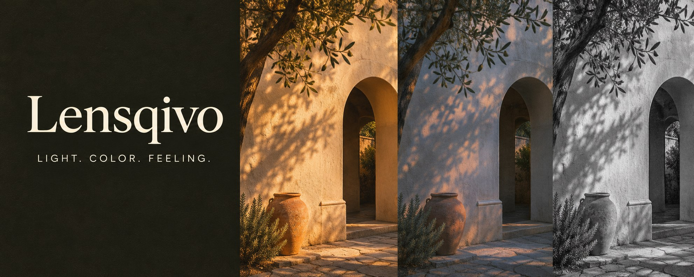

  

<h1 align="center">Lensqivo</h1>

  <strong>An everyday Android camera with a considered sense of color.</strong> 
  Native capture. Original live looks. A little more feeling in the frame.

  

  <a href="#the-camera">The camera</a> &nbsp;·&nbsp;
  <a href="#build-it">Build it</a> &nbsp;·&nbsp;
  <a href="#under-the-viewfinder">Architecture</a> &nbsp;·&nbsp;
  <a href="#development-status">Development status</a>

> **Early development · v0.1.0**
>
> This repository contains the first application source. Core behavior tests pass locally; Android compilation, real capture and device UI verification are still pending. There is no verified installable release yet. The cover is AI-generated brand artwork, **not** an app screenshot or a photograph captured with Lensqivo.

## A name with a point of view

**Lensqivo** is pronounced **Lens-kee-vo**.

| Lens | Q | Vivo |
| :--- | :--- | :--- |
| Photography and camera optics | Quality | Vivid, lifelike imagery |

The idea is simple: a camera that puts the moment first, with a small collection of useful creative choices close at hand. Charcoal surfaces, warm paper tones and amber accents keep attention on the viewfinder.

## The camera

The following features are **implemented in source**. Device qualification is tracked separately in the [validation record](docs/validation.md).

| Capture | Color | Control |
| :--- | :--- | :--- |
| JPEG photos through CameraX | Four original live looks | Tap-to-meter |
| MP4 video through CameraX Recorder | Adjustable look intensity | Capability-dependent zoom and exposure |
| Supported FHD → HD → SD selection | Original / processed comparison | Front / rear camera switching |
| Optional microphone audio | Shared preview / output color transform | Composition grid and local preferences |
| Explicit recording and saving states | Original-only effect recovery | System photo picker and last-capture opening |

The shutter stays outside the scrolling adjustments. Settings open in a sheet, and a recording remains owned until CameraX reports finalization. Sound interruptions are surfaced instead of treating microphone permission as proof of recorded audio.

### Four looks, room to make them yours

| Original | Sol | Dusk | Silver |
| :--- | :--- | :--- | :--- |
| True to the light | Warm light, soft color | Cool air, quiet color | Light and shadow |

These are original creative color transforms. They do not claim to reproduce a proprietary film stock. Grain, halation and advanced tone curves are research directions, not existing features. Shared rendering is designed to reduce preview/export differences; actual color, framing and output resolution still need chart-based device tests.

## Local capture, fewer permissions

- The application manifest requests camera access and optional microphone access. It does not request Internet, location or broad media-library permissions.
- There are no accounts, advertisements or analytics integrations in the application source.
- Photos save to `DCIM/Lensqivo`; videos save to `Movies/Lensqivo` through Android MediaStore.
- Denying microphone access leaves silent video available. Recording stops when the application leaves the foreground.
- Your gallery and Android backup provider may apply their own settings to saved media. Lensqivo does not provide a cloud-upload service.

## Build it

### Prerequisites

| Tool | Project configuration |
| :--- | :--- |
| Android Studio | A version compatible with Android Gradle Plugin 9.2.1 |
| Android SDK | Platform 37 and Build Tools 36.0.0 |
| JDK | 17 for the CI build |
| Gradle | 9.8.2 through the included wrapper |
| Minimum Android version | Android 10 / API 29 |

~~~sh
git clone https://github.com/SHUBHRAGHAVT-57/Lensqivo.git
cd Lensqivo
~~~

Open the project in Android Studio and configure the SDK location. The generated `local.properties` stays out of Git.

**Windows / PowerShell**

~~~powershell
.\gradlew.bat --gradle-user-home .gradle-user-home :core:check :app:assembleDebug :app:lintDebug :app:assembleDebugAndroidTest
~~~

**macOS / Linux**

~~~sh
bash gradlew :core:check :app:assembleDebug :app:lintDebug :app:assembleDebugAndroidTest
~~~

After a successful build, the development APK is written to `app/build/outputs/apk/debug/app-debug.apk`. Its debug signature is for development; it is not a production release.

### Core tests without an Android SDK

With Java 17+ and Node.js 20+:

~~~sh
node scripts/test-core.mjs
~~~

The current suite passes **421 assertions** covering capture ownership, repeated taps, stop-before-start, finalization, stale callbacks and color-transform behavior. This assertion count is not a claim of 421 independent test scenarios.

On an isolated Android test device or emulator, run the instrumented UI/recovery tests with:

~~~sh
bash gradlew :app:connectedDebugAndroidTest
~~~

## Under the viewfinder

~~~text
app/                 Kotlin / Compose application
  CameraSession      CameraX resources, capabilities, capture and finalization
  CameraScreen       Viewfinder, creative controls, settings and semantics
  MainActivity       Permissions, ViewModel ownership, picker and media opening
core/                Java capture-state gate and original color math
scripts/             Dependency-free core test launcher
assets/              Original repository artwork and provenance
docs/                Product decisions, research and validation requirements
~~~

CameraX owns the camera and recording pipeline. Media3 supplies the shared GPU color-effect path. The app does not implement its own MediaCodec/MediaMuxer recorder or full-resolution bitmap readback renderer.

The CameraX Media3 adapter is currently **`1.0.0-alpha04`**. Its integration is isolated in `CameraSession`; compatibility, memory use and image quality require real-device validation. See the [research and technical decisions](docs/research.md) for sources and trade-offs.

## Development status

| Gate | Current evidence |
| :--- | :--- |
| Core behavior | 421 assertions executed successfully locally |
| Manifest and resource XML | Parsed successfully |
| Source formatting checks | `git diff --check` passed before publication |
| Android build and lint | CI configured; local execution blocked by missing SDK/network access |
| Instrumented tests | Written; not yet executed |
| Real photo/video, GPU parity and accessibility | Device qualification pending |

The [Android quality workflow](https://github.com/SHUBHRAGHAVT-57/Lensqivo/actions/workflows/android.yml) validates the wrapper, runs the core gate, builds the debug app, runs Android lint and compiles the instrumented tests. It does **not** run a camera or execute device tests. Check the actual workflow result before relying on an artifact.

### What comes next

1. Pass the complete Android build and qualify real JPEG/MP4 capture across representative devices.
2. Verify preview/output framing, color, mirroring and saved resolution with test charts.
3. Stress recording lifecycle, sound interruptions, low storage and process death.
4. Refine film-style tone and grain only after the existing capture path is proven.

RAW video, Log/HDR, LUT import, manual sensor controls, cloud sync and subscriptions are outside this version. The [validation checklist](docs/validation.md) defines the release gates and device matrix.

## Contributing and ownership

Issues with a device model, Android version, exact reproduction steps and expected/actual behavior are useful. Avoid sharing personal photos, private media links or signing material in bug reports.

Lensqivo is an independent implementation. No FilterCam source, presets, shaders, branding or artwork were copied. Gradle wrapper files and AndroidX dependencies retain their upstream licenses. No license grant for Lensqivo's original source has been selected yet; public visibility alone does not grant permission to reuse it. Cover provenance is documented [here](assets/README.md).

<strong>Lensqivo</strong> · Light. Color. Feeling.

