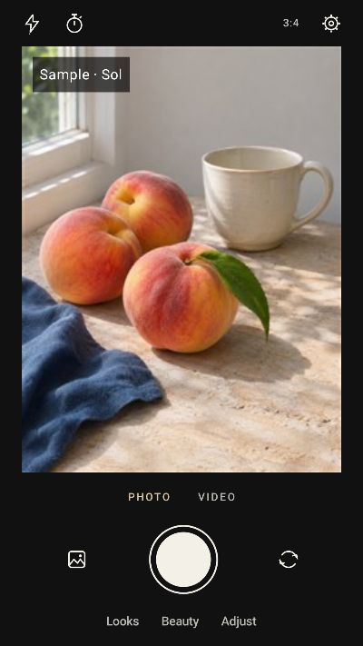
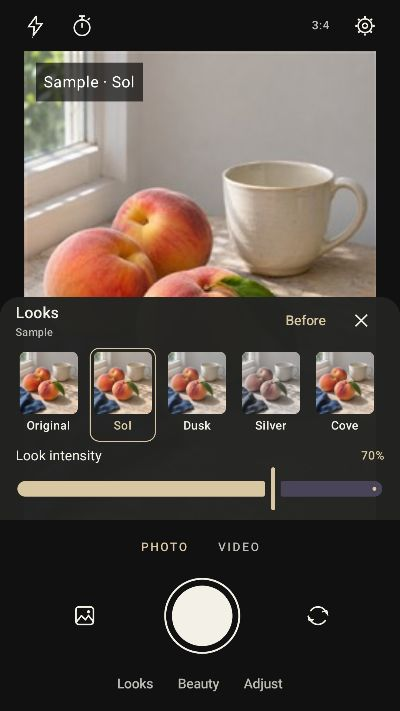
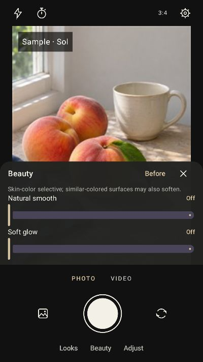

# Evaluate Lensqivo

Lensqivo is a development camera application for Android 10 or newer. You can explore the interface and code without signing in.

## Walk through without signing in

The images below show the native Compose interface on a software-rendered emulator using a generated reference scene. The [assets guide](../assets/README.md) identifies the source commit and run.





1. The camera view keeps the shutter dock in place. Photo and video use CameraX. You can record silent video without microphone permission.
2. **Looks** offers eight color transforms with adjustable strength. **Before** compares the original and pauses capture until returning to the selected look.
3. **Beauty** controls smoothing and glow, both off by default. Smoothing selects by skin-like colors and can also affect similarly colored objects.
4. **Settings** contains capture defaults, composition options, three local recipe slots, reset, and unsaved-original recovery. The app disables settings that affect capture while a capture owns the session.
5. Photos save through MediaStore to `DCIM/Lensqivo`. Videos go to `Movies/Lensqivo`. Interrupted photo transactions can retain a native original for recovery.

See [Engineering decisions](ENGINEERING.md), [Verification](VERIFICATION.md), and [hardware validation](validation.md) for how these paths work and what has been tested.

## Install a development build

1. Open the [Android workflow page](https://github.com/SHUBHRAGHAVT-57/Lensqivo/actions/workflows/android.yml) and choose the latest successful `main` run. For example, [run 41955799779](https://github.com/SHUBHRAGHAVT-57/Lensqivo/actions/runs/41955799779) passed debug checks for `9f3a8412` on November 5, 2026, and its artifacts have expired.
2. If a `lensqivo-development-build-api29` or `lensqivo-development-build-api35` artifact is available, sign in and download it. The suffix identifies the CI test emulator. Either debug APK supports Android 10 or newer. Builds are retained for seven days. See [GitHub's artifact instructions](https://docs.github.com/en/actions/how-tos/manage-workflow-runs/download-workflow-artifacts).
3. Extract the archive and locate `debug/app-debug.apk`. Builds from the updated workflow include `SOURCE.txt` with the checked-out commit and `SHA256SUMS` alongside the `debug/` and `release/` folders. Run `sha256sum --check SHA256SUMS` from that directory, or compare `Get-FileHash .\debug\app-debug.apk -Algorithm SHA256` in PowerShell. The unsigned release APK is for build validation.

If artifacts have expired, a local build also works without a GitHub account. Set up the [build prerequisites](../README.md#build-it), then run the same clean build tasks as CI.

```powershell
# JDK 17 and the documented Android SDK packages must already be installed.
.\gradlew.bat --gradle-user-home .gradle-user-home clean :core:check :app:assembleDebug :app:assembleRelease :app:lintDebug :app:lintRelease :app:assembleDebugAndroidTest --no-daemon
```

On macOS or Linux, replace `.\gradlew.bat` with `bash gradlew`. The debug APK is at `app/build/outputs/apk/debug/app-debug.apk`. The unsigned release APK is under `app/build/outputs/apk/release/`.

Install the debug APK on a test device or emulator through Android's installation prompt. Development signing keys can differ between builds. Save your media and recover pending originals before uninstalling an older build, since uninstall removes the app's private settings and pending files.
